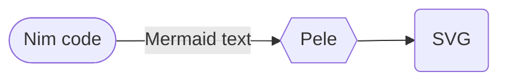

# diagrammari, imported as `mari`

*this is a diagram, you know this diagram, but this is my diagram*

> *Diagrammari*: "to diagram", the Italian verb *diagrammare* with a Sicilian ending; and in it
> *mari*, the seas (after the Mermaid), and Enzo and Iela Mari. Here: diagrams for Nim, drawn by
> [Pele](https://pele.run). The repository is diagrammari; the package and the module are `mari`.

**diagrammari** makes diagrams in Nim. Write [Mermaid](https://mermaid.js.org) text, or build
flowcharts, sequence diagrams, pie charts and timelines with Nim verbs; Pele, kepano's new
renderer for Mermaid text, draws them as SVG, when the page is built (through Node, so the page
needs no JavaScript) or in the reader's browser. It fits in
[nimib](https://github.com/pietroppeter/nimib) notebooks.

**Site:** [pietroppeter.github.io/diagrammari](https://pietroppeter.github.io/diagrammari/), with the
[explainer](https://pietroppeter.github.io/diagrammari/explainer/) (Mermaid, Pele, and the art of
diagrams from Priestley to Sugiyama), the [specs](https://pietroppeter.github.io/diagrammari/specs/)
and the [devlog](https://pietroppeter.github.io/diagrammari/devlog/).

> **Status: a first version, a proof of concept.** The API will change.

```nim
import mari

let f = flowchart(LR):
  node "nim", "Nim code", stadium
  node "pele", "Pele", hexagon
  node "svg", "SVG", round
  link "nim", "pele", "Mermaid text"
  "pele" --> "svg"
echo f            # the Mermaid text, below
f.save "flow.svg" # drawn by Pele, at build time
```



(GitHub draws that block with Mermaid; the site draws the same text with Pele.)

Any of Pele's 33 diagram types works as text: `diagram"""mindmap ..."""`. In a nimib notebook,
`import mari/nimib` and `nbDiagram f`.

## Living documents

Kept up to date as diagrammari changes:

- [Explainer](https://pietroppeter.github.io/diagrammari/explainer/): what Mermaid and Pele are, how
  Pele lays out a drawing, where each kind of diagram comes from, and diagrammari step by step.
- [Specs](https://pietroppeter.github.io/diagrammari/specs/): how diagrammari behaves today, written
  down with [OpenSpec](https://github.com/Fission-AI/OpenSpec) in `openspec/`, with examples that
  run against the code, and the diagrams they draw, while the page is built.
- [Devlog](https://pietroppeter.github.io/diagrammari/devlog/): the living documents, then the posts.

Posts, dated and not updated afterwards:

- [Diagrams, a series in five parts](https://pietroppeter.github.io/diagrammari/devlog/diagrams-series/)
  (7 Nov 2026): how diagrammari came about. The first post, and the index of a series on the
  history of diagrams, everyday diagrams, making them yours, the name and the house style, each
  part in the style of its own figure (`docs/series/`).
- [Day one: from Mermaid to Pele to diagrammari](https://pietroppeter.github.io/diagrammari/devlog/day-one/)
  (7 Nov 2026): reading Pele, deciding to wrap it rather than rewrite it, and a first diagrammari.

## Files

- `src/mari.nim`: the module to import, with the block macros (`flowchart(...): body` and friends).
- `src/mari/core.nim`: `Diagram`, its kind, Markdown, and the quoting the builders share.
- `src/mari/flowchart.nim`, `sequence.nim`, `pie.nim`, `timeline.nim`: the builders.
- `src/mari/pele.nim`: Pele (`vendor/pele.global.js`, `peleVersion`), the Node server, `toSvg`.
- `src/mari/render_html.nim`: `toHtml` (static or client), `peleScript`, `save`.
- `src/mari/theme.nim`: `Theme`, the `--pele-*` variables. `src/mari/nimib.nim`: the `nbDiagram` block.
- `tests/`: `nim r tests/all.nim`. `tools/specexamples.nim`: runs the examples of the specs.
- `docs/`: the pages, as nimib notebooks (`docs/all.nim` builds them all; `docs/tavola.nim` is the theme).
- `openspec/`: specs and open changes; `openspec/config.yaml` has the rules. `BACKLOG.md`, `CHANGELOG.md`, `AGENTS.md`.

## Building

```sh
sh tools/setup.sh                # once: what is missing (Nim, atlas, libpcre3) + deps from atlas.lock
nim r tests/all.nim              # tests
nim r tools/specexamples.nim     # the examples of the specs
nim r -d:release docs/all.nim    # every page, into docs/
```

Drawing at build time needs [Node](https://nodejs.org) 20 or later on the PATH (or at
`$MARI_NODE`); without it, diagrams are drawn in the browser. With Nim and atlas already
installed, `atlas rep --feature=docs` is all the setup does on a laptop. Dependencies are managed
with [atlas](https://github.com/nim-lang/atlas): nimib is the `docs` feature of
`mari.nimble`, pinned in `atlas.lock`, cloned into `deps/`, and `nim.cfg` puts it on the path.

The library itself needs only Nim (2.0 or later) and its standard library. CI
(`.github/workflows/pages.yml`) runs the tests and the examples, builds the pages and deploys them
to GitHub Pages from `main`.

## License

MIT. Pele (`src/mari/vendor/pele.global.js`, version 1.13.0) is by kepano, MIT
(`src/mari/vendor/PELE-LICENSE`). The fonts in `docs/assets/fonts` (Architects Daughter,
IBM Plex, Arimo) are under the SIL Open Font License.
