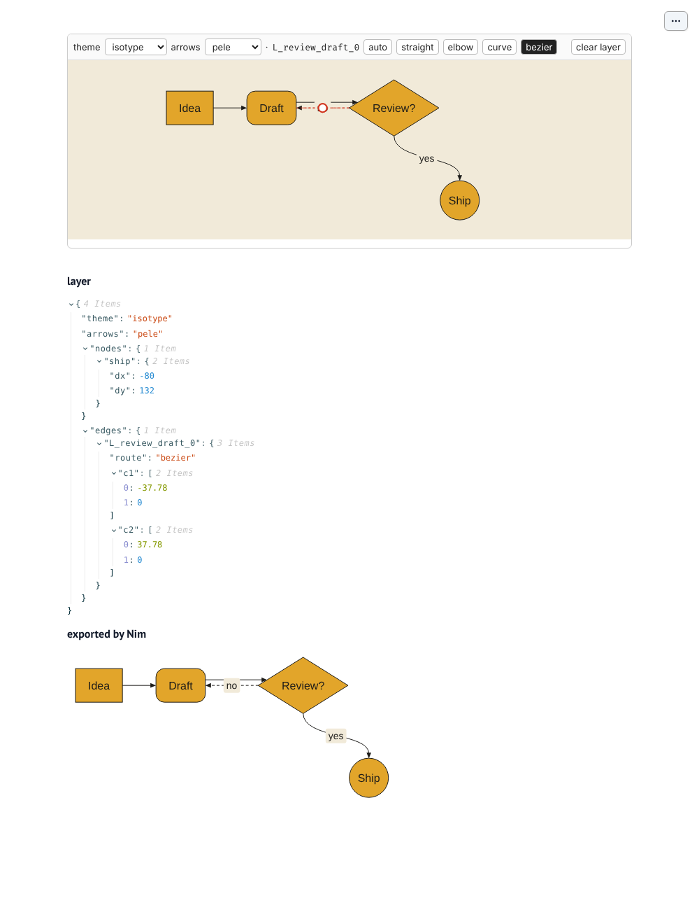

# diagrammari for Python: a proof of concept

Not the package yet. This folder checks, end to end, the plan in three OpenSpec changes:
[`add-personal-layer`](../../openspec/changes/add-personal-layer/proposal.md),
[`add-python-package`](../../openspec/changes/add-python-package/proposal.md) and
[`add-notebook-editor`](../../openspec/changes/add-notebook-editor/proposal.md).

What it shows, all of it run on 7 Nov 2026 (Linux, Python 3.13, Nim 2.2.4):

- **A Nim library in a Python wheel.** `nim/capi.nim` is compiled with `--app:lib` into
  `libmari.so` and loaded with `ctypes` (no nimpy). `uv build` compiles it through a hatchling
  hook (`hatch_build.py`) and tags the wheel `py3-none-<platform>`, so one wheel serves every
  Python 3 on that platform. `uv add ./dist/diagrammari-0.0.1-py3-none-linux_x86_64.whl`
  in a new project, then `import mari`, works.
- **Pele without Node.** QuickJS (quickjs-ng, MIT, `nim/vendor/quickjs`, pinned in `COMMIT`)
  is compiled into `libmari` by Nim's C compiler (`nim/qjs.nim` and a small C shim,
  `nim/mari_qjs.c`). Pele runs in it unchanged: the same SVG as Node, byte for byte, for a
  flowchart, a sequence, a pie and a class diagram (`nim/qtest.nim`), at about 0.8 ms a diagram
  after a 100 ms load. The wheel is 1.3 MB, and `uv add` installs nothing else. `MARI_ENGINE=node`
  switches back to Node (the `[node]` extra brings it from PyPI); checked too, with `node` taken
  off the `PATH`.
- **The personal layer headless.** `nim/layer.nim` applies a layer (offsets, fills, arrow routes,
  Bézier handles) to Pele's SVG text, with the same geometry as the browser editor. About 2 ms.
- **One editor, three places.** `src/mari/widget.js` is an
  [anywidget](https://anywidget.dev) module: it draws with Pele in the browser, lets you drag
  boxes and shape arrows, and syncs the layer back to Python. Checked with Playwright in
  marimo 0.25.2 (`mo.ui.anywidget`), in JupyterLab 4.6.6, and outside notebooks
  (`Diagram.edit_in_browser()`, a one-page server on 127.0.0.1 that returns the layer when you
  press Done).



## Try it

```sh
cd experiments/python
uv build --wheel                       # needs nim on the PATH
cd /some/new/project && uv init --bare
uv add "/path/to/diagrammari/experiments/python/dist/diagrammari-0.0.1-py3-none-linux_x86_64.whl[node,widget]"
uv add marimo && uv run marimo edit /path/to/diagrammari/experiments/python/examples/marimo_app.py
```

```python
import mari
d = mari.Diagram("flowchart LR\n  a[Start] --> b[End]")
d                                  # an SVG in Jupyter and marimo (_repr_svg_, _mime_)
w = d.edit(); w                    # the editor; d.layer follows it
d.layer                            # {'theme': 'pele', 'arrows': 'pele', 'nodes': {'b': {'dx': 68, 'dy': 124}}, 'edges': {}}
d.save("mine.svg")                 # Mermaid + layer -> SVG, drawn headless
```

## Files

| file | what |
|---|---|
| `nim/capi.nim` | the C ABI: `mari_draw(request JSON) -> answer JSON`, `mari_free`, `mari_pele_version`, `mari_engine` |
| `nim/qjs.nim`, `mari_qjs.c`, `vendor/quickjs/` | Pele in QuickJS, compiled in; `qtest.nim` compares it with Node |
| `nim/layer.nim` | the layer applied to Pele's SVG (std/xmltree, no regex so no libpcre) |
| `src/mari/__init__.py` | `Diagram`, `draw`, `DiagramError`, the ctypes loader |
| `src/mari/widget.py`, `widget.js` | the anywidget editor (Pele's bundle is put in front of the module) |
| `src/mari/browser.py` | `edit_in_browser`: the same module with a stand-in model |
| `examples/` | a marimo app, a Jupyter notebook, a headless export |

## Found on the way

- marimo puts each anywidget in a shadow root: a `<style>` added to `document.head` does not
  reach it. The style goes inside the widget's element (or in `_css`).
- `std/re` loads libpcre at run time: fine for a Nim program, wrong in a wheel. `layer.nim`
  reads numbers by hand.
- The Node wheel is big: 61 MB to download, 204 MB installed. That is why QuickJS: compiled in,
  it adds about 1.2 MB to the library, and the export of the proof of concept gives the same file
  with either engine.
- QuickJS builds with Nim's `{.compile.}` pragma and `-D_GNU_SOURCE`, no CMake, in about 20 s.
- In the browser, the editor and Nim agree on positions to within the 4 px snap; fonts differ
  when the theme's font is not installed (the editor measures with the page's fonts, Node with
  Arial's widths).
